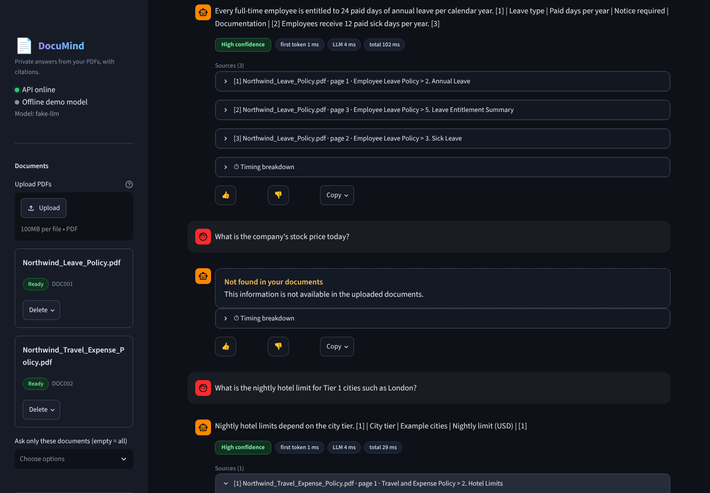
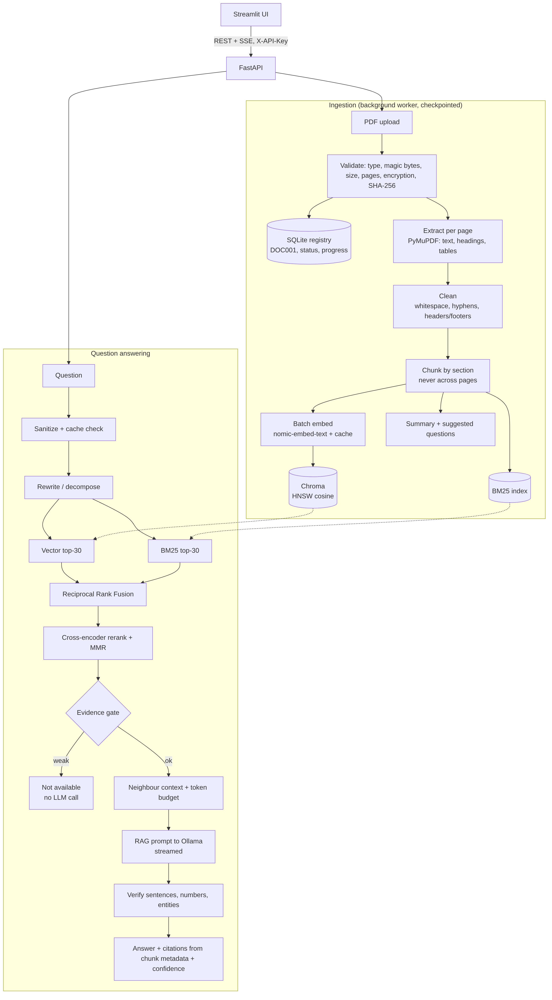

# Document Q&A Assistant

Ask questions about your own PDFs and get answers **with citations (document + page)**. It runs fully
locally: FastAPI + Chroma + SQLite + Ollama on your own GPU, with a Streamlit UI on top. Built from the
*Document Q&A Assistant: Production Roadmap* (all 22 sections, including the Streamlit UI and the large-PDF
accuracy plan).



| | |
|---|---|
| **Private** | Nothing leaves your machine. No cloud calls. |
| **Trustworthy** | Citations are built from chunk metadata (never from model text), a confidence badge, an honest "not available" answer instead of a guess, and a verification pass on numbers and sentences. |
| **Fast** | Streaming answers, warm start, answer cache, early exit (no LLM call when evidence is weak), per-stage timings. |
| **Accurate on long PDFs** | Hybrid search (vectors + BM25, Reciprocal Rank Fusion), cross-encoder reranker, section-aware and table-aware chunking, neighbour context, MMR diversity. |
| **Engineered** | 270 passing tests, strict typing, ruff, bandit, rate limiting, API keys, Docker (non-root), CI. |

---

## 1. Run it in VS Code (Windows / macOS / Linux)

**Prerequisites:** Python 3.11 or 3.12, VS Code, and [Ollama](https://ollama.com/download) (for real answers).

### Option A: try it in 2 minutes with no Ollama (offline demo)

Open the unzipped folder in VS Code (`File > Open Folder`), open a terminal (`Ctrl+` ` ``) and run:

```powershell
# Windows PowerShell
python -m venv .venv
.venv\Scripts\Activate.ps1          # if blocked: Set-ExecutionPolicy -Scope Process Bypass
pip install -r requirements-dev.txt
python run_all.py --demo --seed
```

```bash
# macOS / Linux
python3 -m venv .venv && source .venv/bin/activate
pip install -r requirements-dev.txt
python run_all.py --demo --seed
```

Open **http://localhost:8501** (UI) and **http://localhost:8000/docs** (Swagger, API key `demo-key`).
The demo uses a deterministic stand-in for the models, so answers are extractive and simple. It proves the
whole pipeline, UI and API, but for real answer quality use Option B.

### Option B: real models (Ollama on your GPU)

```powershell
ollama pull qwen2.5:3b-instruct        # LLM, about 2 GB, fits a 6 GB RTX 3050
ollama pull nomic-embed-text           # embeddings
nvidia-smi                             # confirm the GPU is visible
ollama ps                              # after the first question: PROCESSOR should say 100% GPU

Copy-Item .env.example .env            # macOS/Linux: cp .env.example .env
# edit .env: set API_KEYS and API_KEY to the same long random value
python run_all.py
```

* UI: http://localhost:8501 | Swagger: http://localhost:8000/docs (click **Authorize**, paste your key)
* **Ctrl+C** stops both processes.
* Optional accuracy boost (cross-encoder reranker, large PyTorch download): `pip install -r requirements-rerank.txt`.
  Without it, a lightweight lexical reranker is used automatically (`/ready` shows which one is active).

### VS Code shortcuts

* **Run and Debug** panel: *API (uvicorn, debug)*, *UI (Streamlit)*, *Run everything (demo)*, *Pytest: current file*.
* **Terminal > Run Task**: run app, tests, coverage, lint, evaluation.
* Testing sidebar discovers all tests (pytest is preconfigured). Recommended extensions are suggested on open.

---

## 2. Using it

1. Drop PDFs into the sidebar uploader. A progress bar shows pages processed while ingestion runs in the background.
2. Ask a question in **Chat**. Open a source card to see the exact passage and a **rendered image of the cited page**.
3. **Documents** tab: summary and suggested questions per document. **Insights** separates live, PDF-attributed
   interaction metrics from the fixed 18-question sample benchmark. The benchmark reports pass rate, verifier
   groundedness, citation accuracy against gold pages, out-of-document hallucinations, retrieval Recall@5/10,
   MRR, latency, and per-question diagnostics. Answer and context relevance are deterministic token-overlap
   diagnostics; coherence appears only when a real LLM judge ran. Refresh the benchmark with
   `python -m eval.run_eval` (Ollama) or `python -m eval.run_eval --fake` (offline plumbing check).
   **About**: architecture and privacy.
4. Use the sidebar filter to ask only selected documents, and *Deep mode* to route a question to the 7B model.

### API (curl)

```bash
KEY=change-me-dev-key
curl -H "X-API-Key: $KEY" -F "file=@sample_pdfs/Northwind_Leave_Policy.pdf;type=application/pdf" http://localhost:8000/documents/upload
curl -H "X-API-Key: $KEY" http://localhost:8000/documents
curl -H "X-API-Key: $KEY" -H "Content-Type: application/json" \
     -d '{"question":"How many days of annual leave do employees get?"}' http://localhost:8000/ask
```

| Method | Path | Purpose |
|---|---|---|
| POST | `/documents/upload` | Upload a PDF (202, processed in background) |
| GET | `/documents`, `/documents/{id}` | List, status and progress with ETA |
| DELETE | `/documents/{id}` | Remove vectors, file and record |
| POST | `/documents/{id}/resume` | Resume an interrupted ingestion from its checkpoint |
| GET | `/documents/{id}/pages/{n}/preview` | PNG of a page (for source cards) |
| GET | `/documents/{id}/summary` | Auto summary and suggested questions |
| POST | `/ask` | Answer with citations, confidence, timings |
| POST | `/ask/stream` | Same, streamed (Server-Sent Events: `token`*, then `final`) |
| POST | `/feedback`, GET `/metrics/recent` | Thumbs up/down, Insights data |
| GET | `/health`, `/ready` | Liveness, readiness (LLM, embedder, vector store) |

Example `/ask` response (trimmed):

```json
{"answer": "Every full-time employee is entitled to 24 paid days of annual leave ... [1]",
 "answered": true, "confidence": "high",
 "citations": [{"document_id": "DOC001", "document": "Northwind_Leave_Policy.pdf", "page": 1}],
 "sources": [{"number": 1, "page": 1, "section": "Employee Leave Policy > 2. Annual Leave", "snippet": "...", "score": 0.91}],
 "timings": {"embed_ms": 12.4, "vector_ms": 3.1, "bm25_ms": 0.6, "rerank_ms": 41.0, "llm_ms": 2310.0, "total_ms": 2390.5}}
```

**Postman:** import `docs/postman_collection.json` and `docs/postman_environment.json`, set `apiKey`, then run the
collection top to bottom (it includes test scripts for every status code path).

---

## 3. Tests and quality gates

```bash
pytest                                      # unit + integration + security + frontend (281 passed, 3 deselected)
pytest --cov=app --cov-report=term-missing  # coverage gate: 85% (currently 95.6%)
ruff check app tests eval frontend && ruff format --check app tests eval frontend
mypy                                        # strict
bandit -q -r app -ll
pip-audit -r requirements.txt
python -m eval.run_eval --fake --strict     # evaluation smoke test (offline)
pytest -m e2e                               # needs Ollama running with both models pulled
pytest -m browser                           # Playwright test against a running UI (DOCQA_UI_URL overrides :8501)
locust -f tests/perf/locustfile.py --host http://localhost:8000 -u 5 -r 1 -t 60s --headless
python -m eval.bench_scale                  # latency / memory at 1k, 10k, 50k chunks
```

What is covered: every service (cleaner, chunker incl. property tests, prompt builder snapshots, citations,
retriever, reranker, verifier, cache, embedder and LLM client with mocked Ollama), integration tests with real
Chroma and SQLite in temp dirs (upload, duplicate 409, delete, restart persistence, crash-resume with no duplicate
chunks, corrupt/scanned/encrypted PDFs, concurrent uploads), API status codes (400/401/404/409/413/415/422/429/503/504),
security tests (wrong key, oversize, wrong type, path traversal filename, disguised PDF, prompt-injection PDF,
rate limit), large-PDF needle-in-haystack tests, and Streamlit AppTest flows plus a UI-to-OpenAPI contract test.

---

## 4. Docker

```bash
cp .env.example .env          # set API_KEYS and API_KEY
docker compose up --build     # API :8000, UI :8501; Ollama stays on the host (host.docker.internal)
```

Slim multi-stage images, non-root user, healthchecks, read-only root filesystem, dropped capabilities,
persistent volume for `data/`. *Docker files were written to the roadmap but not built in the authoring
sandbox (no Docker there); CI builds them.*

---

## 5. Configuration (`.env`)

| Setting | Default | Purpose |
|---|---|---|
| `API_KEYS` / `API_KEY` | none | Accepted keys / key the UI uses |
| `LLM_MODEL`, `DEEP_LLM_MODEL`, `EMBED_MODEL` | `qwen2.5:3b-instruct`, `qwen2.5:7b-instruct-q4_K_M`, `nomic-embed-text` | Models |
| `CHUNK_SIZE`, `CHUNK_OVERLAP` | 700, 100 | Retrieval granularity |
| `CANDIDATES_K`, `FINAL_K` | 30, 5 | Candidates per method, passages sent to the LLM |
| `MIN_SIMILARITY` | 0.60 | Evidence gate (below it: "not available", no LLM call). **Tune with the evaluation.** |
| `HNSW_EF_SEARCH`, `EMBED_BATCH_SIZE` | 100, 64 | Recall vs latency, ingestion throughput |
| `RERANK_ENABLED`, `VERIFY_ENABLED` | true | Accuracy vs speed |
| `MAX_FILE_MB`, `MAX_PAGES` | 100, 1000 | Abuse protection |
| `CONTEXT_TOKEN_BUDGET`, `NUM_CTX`, `NUM_PREDICT` | 3000, 4096, 256 | Keeps the 4096 window from overflowing |
| `RATE_LIMIT_ASK_PER_MIN`, `RATE_LIMIT_UPLOAD_PER_MIN` | 30, 10 | Per key and per IP |

### Tuning (recommended before a demo)

1. Upload your real PDFs, write 15 to 20 questions into `eval/questions.json` (the format is self-explanatory).
2. `python -m eval.run_eval --ablation` and read `eval/results/latest.md`.
3. If good questions are refused, lower `MIN_SIMILARITY` slightly; if off-topic questions get answered, raise it.

---

## 6. Design decisions

* **Citations come from metadata.** The model cites passage numbers like `[2]`; the app maps them to
  (document, page) from the retrieved chunks and ignores invalid numbers, so a page can't be invented.
* **Chunks never cross pages**, and carry their heading path (`Leave Policy > Maternity Leave`). Tables become
  Markdown chunks with the header row repeated if split.
* **Hybrid retrieval**: embeddings find meaning, BM25 finds exact clause numbers and names; Reciprocal Rank Fusion
  merges them. A cross-encoder reranker picks the best 5 and MMR removes near-duplicates. Multi-part questions are
  split into sub-questions and their evidence merged.
* **Honest refusal**: a weak-evidence gate returns "not available" without calling the LLM (instant, and no
  hallucination). The embedding model name is stored with the index; a mismatch is refused (409).
* **Ingestion is streaming and resumable**: page-by-page, batched embeddings, an embedding cache keyed by
  SHA-256(text + model), deterministic chunk IDs (idempotent), checkpoints in SQLite.
* **Backends behind interfaces**: swapping Ollama for another LLM or embedder is a class, not a rewrite.

## 7. Measured results (be aware of what these are)

* **Tests:** 281 passed, 3 deselected in the latest full run. Earlier app coverage was 95.6%.
* **Retrieval scale benchmark** (`eval/results/scale_benchmark.json`; synthetic vectors, so index + fusion + rerank only):

  | Chunks | p50 | p95 | Peak RSS |
  |---|---|---|---|
  | 1,000 | 16 ms | 19 ms | 250 MB |
  | 10,000 | 21 ms | 26 ms | 363 MB |
  | 50,000 | 44 ms | 57 ms | 636 MB |

  p95 retrieval at 50,000 chunks is well under the roadmap target of 150 ms.
* **Developer benchmark (`eval/results/latest.json` and `latest.md`)** contains results for the project's fixed
  sample corpus and is refreshed with `python -m eval.run_eval --ablation` when Ollama is available. These
  benchmark results are separate from user Insights: they are never loaded into the Insights API or exported
  as metrics for a user's uploaded PDFs. Insights only includes actual, document-attributed interactions and
  verifier outputs; it does not fabricate benchmark questions, coherence scores, retrieval recall, or
  hallucination-rate estimates.
* **Not measured in this run:** Docker build/smoke test because the Docker daemon was unavailable.

## 8. Limitations and roadmap

* Scanned PDFs are detected and rejected with a clear message; **OCR (Tesseract) is not included**.
* A 3B model can still make mistakes; the gate, strict prompt and verification reduce but cannot eliminate them.
* The cross-encoder reranker and an NLI/LLM-judge verification pass are optional or heuristic: verification
  here is lexical sentence/number/entity support, not a trained entailment model.
* Single-tenant: one API key space, no per-user document isolation. Terminate HTTPS at a reverse proxy in deployment.
* Next steps: OCR, per-user isolation, Prometheus/Grafana, parent-child chunk storage.

## 9. Security notes

API key (constant-time compare, from env), per-key and per-IP rate limits, extension + MIME + magic-byte checks,
size and page limits, encrypted/corrupt PDFs rejected, server-generated filenames (path traversal impossible),
input validation and control-character stripping, delimited and escaped context with an "untrusted data" instruction
and no tools for the model, citations from metadata only, no document text or keys in logs, generic error messages
(no stack traces), restricted CORS, security headers, pinned dependencies with pip-audit/bandit in CI,
non-root read-only containers.

## 10. Troubleshooting

| Symptom | Fix |
|---|---|
| UI banner "backend not reachable" | Start the API (`python run_all.py`), check `API_BASE_URL` |
| 401 in UI | `API_KEY` must equal one of `API_KEYS` |
| 503 "Ollama not reachable" | `ollama serve`; `ollama pull qwen2.5:3b-instruct nomic-embed-text` |
| Slow first answer | Model loading into VRAM; the app warms up at startup and keeps it loaded (`OLLAMA_KEEP_ALIVE`) |
| Everything answers "not available" | Lower `MIN_SIMILARITY`; confirm the embedding model matches the indexed one (`/ready`) |
| "embedding model changed" (409) | Restore `EMBED_MODEL` or delete and re-upload the documents |
| PDF rejected as scanned | It has no text layer; OCR it first (e.g. `ocrmypdf`) |
| PowerShell blocks activation | `Set-ExecutionPolicy -Scope Process Bypass` |

## 11. Three-minute demo script

Problem (20 s) > upload two policies, show progress and summary (30 s) > direct question with source card and page
image (30 s) > multi-section question (20 s) > out-of-document question: "not available" (20 s) > Insights tab (20 s)
> close: local, private, tested, secure (20 s). Pre-warm the model and pre-upload the documents; keep a screen recording as backup.

## Project layout

```
app/        FastAPI backend (api/, services/, db/, core/, schemas/)
frontend/   Streamlit UI (components/, services/, tests/)
tests/      unit/, integration/, security/, e2e/, perf/
eval/       questions.json, run_eval.py, bench_scale.py, stress.py, results/
docs/       architecture.png, postman_collection.json, screenshots/
sample_pdfs/  fictional HR policies (regenerate: python -m eval.sample_docs)
run_all.py  one-command launcher
```


